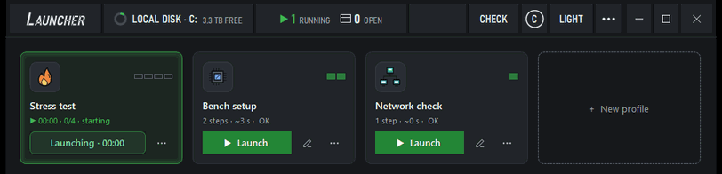
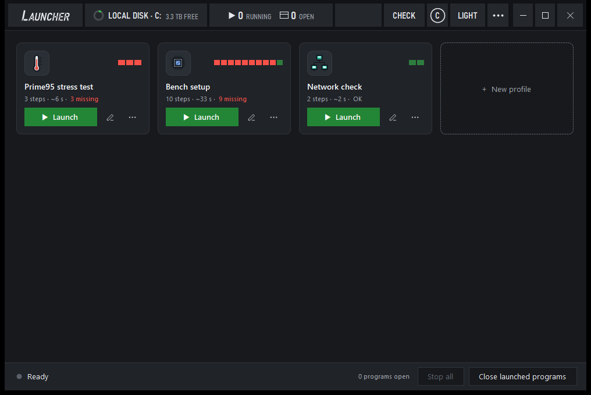
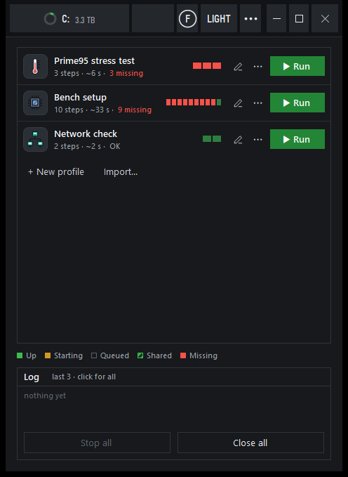
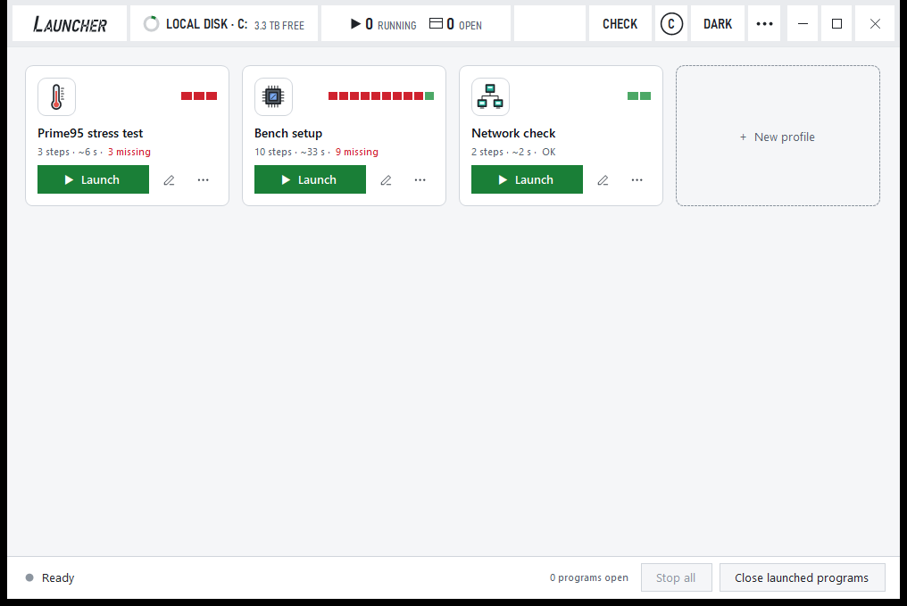
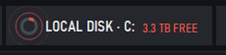

# Launcher

A portable launcher for Windows 10 / 11 that runs from a USB stick. Group programs into **profiles** and start
them in order with one click. Everything it saves stays on the stick.



## Features

- **Profiles:** start programs immediately, after a delay, once the previous one is running, or once it has closed.
- **Scheduling:** pick a delay from common times, your last 3 own times, or any time up to 24 h, with a countdown
  to the next program.
- **Start only:** a profile can be done once everything has started, for tests and benchmarks that run on their own.
- **Timeline editor:** drag a program's bar to set when it starts.
- **Moves with the stick:** paths are stored relative to the stick, so a new drive letter doesn't matter. If a
  program has moved, the launcher asks where it is instead of failing.
- **Several profiles at once,** and **Close all** closes only the programs the launcher started.
- **Keeps the PC clean:** temp files (and optionally AppData) go to the stick.
- **55 icons** for profiles (computers, parts, devices, network, tests, benchmarking) that move while a profile runs.
- **Per-program admin rights,** compact and full layouts, and dark, light and green-phosphor looks.

## Screenshots

| Full layout | Compact layout |
|---|---|
|  |  |

| Dark | Light |
|---|---|
|  |  |

When the stick is almost full, its ring turns red and sends out ripples:



## Getting started

1. Download `Launcher.exe` from [Releases](../../releases) and copy it to your stick.
2. Run it. It creates `profiles.json` with three example profiles next to itself.
3. Set your tools folder in **Settings** and edit the profiles.

No installer needed. .NET Framework 4.8 is built into Windows 10 and 11.

To start a profile from a shortcut, use `Launcher.exe --run "Profile name"`.

## Building

```
dotnet build -c Release
```

The output is `bin\Release\net48\Launcher.exe`. GitHub Actions builds every push. To publish a release, raise
`<Version>` in `LauncherApp.csproj` and push: a release for that version is created with the exe attached.
